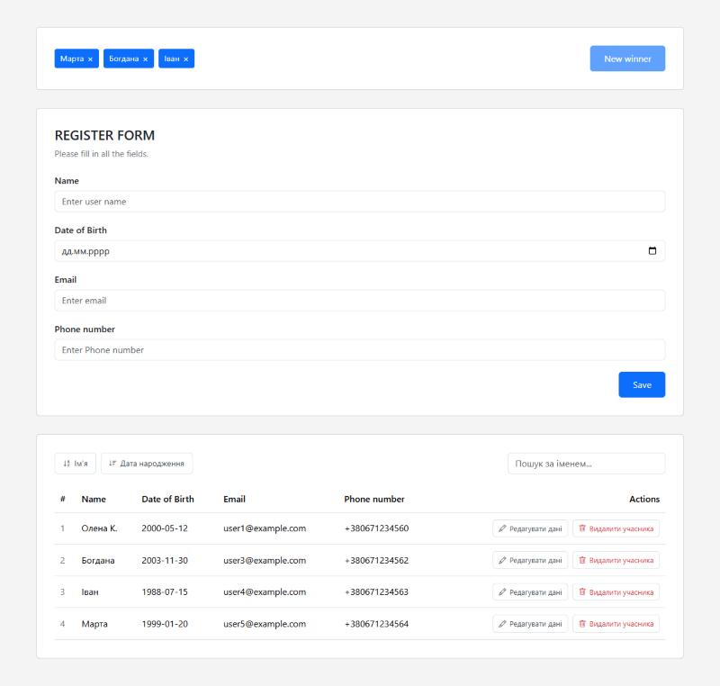
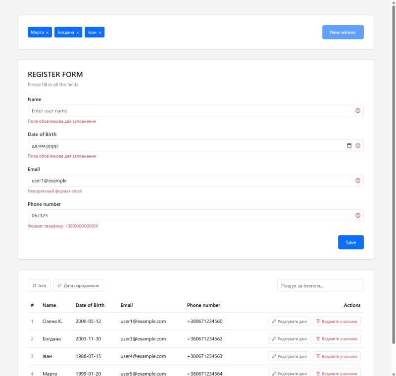
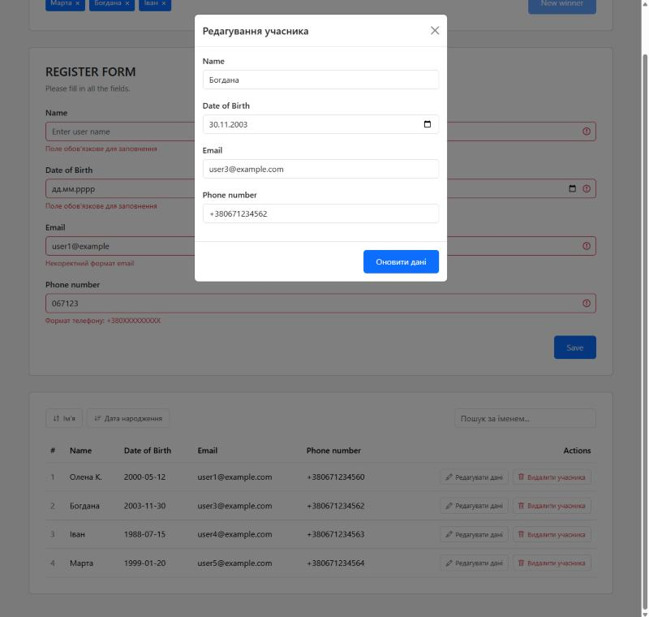

# Vue Lottery: computed, події, форми, props, watchers

Лабораторна робота №4 з курсу «Інженерія клієнтських веб-систем»: Vue 3 (Composition API, `<script setup>`), TypeScript, Vite, Bootstrap 5 (SCSS).
Застосунок-лотерея: реєстрація учасників із валідацією, таблиця з редагуванням, видаленням, сортуванням і пошуком, випадковий вибір до трьох переможців.



|                                         |                                              |
| --------------------------------------- | -------------------------------------------- |
|  |  |
| Помилки валідації без `alert`           | Модальне вікно редагування                   |

## Запуск

```bash
npm install
npm run dev          # dev-сервер Vite
npm run build        # перевірка типів і продакшн-збірка в dist/
npm test             # Vitest
npm run lint:check   # oxlint + ESLint без змін файлів
npm run type-check   # vue-tsc
```

## Завдання і де вони виконані

| Завдання                                                               | Де реалізовано                                                            |
| ---------------------------------------------------------------------- | ------------------------------------------------------------------------- |
| Bootstrap через npm, лише потрібні стилі, SCSS                         | `src/assets/main.scss`                                                    |
| 1. Обов'язкові поля, regexp для email і телефону `+380XXXXXXXXX`       | `src/utils/participantValidation.ts`                                      |
| 1. `input date`, дата народження не з майбутнього                      | `validateParticipantForm`, атрибут `max` у `RegistrationForm.vue`         |
| 1. Save додає учасника й очищує форму без спрацювання валідації        | `RegistrationForm.vue` (`resetForm`)                                      |
| 1. Унікальність email без урахування регістру                          | `validateParticipantForm`                                                 |
| 1. Відправка форми клавішею Enter (`@keyup.enter`)                     | `RegistrationForm.vue`, `EditParticipantModal.vue`                        |
| 2. «New winner»: до трьох переможців, без повторів, неактивна кнопка   | `src/App.vue` (`canPickWinner`, `pickWinner`), `WinnersList.vue`          |
| 2. Видалення переможця з блоку                                         | `WinnerItem.vue`, `App.vue` (`removeWinner`)                              |
| 3. Компоненти: кнопка, поле вводу, переможець, блоки, Modal, SearchBar | `src/components/`                                                         |
| 4. Збереження в `localStorage` через `watch` з `deep`                  | `src/App.vue`                                                             |
| 4. Редагування в модальному вікні з валідацією                         | `EditParticipantModal.vue`, `BaseModal.vue` (слоти, `Teleport`)           |
| 4. Видалення з підтвердженням «Так» / «Ні»                             | `DeleteParticipantModal.vue`                                              |
| 4. Сортування за іменем і датою, повторний клік змінює напрямок        | `src/utils/participants.ts` (`sortParticipants`), `ParticipantsTable.vue` |
| 4. Пошук за іменем, подія `filter-by-name` з debounce 300 мс           | `SearchBar.vue` (`watch` + `setTimeout`)                                  |
| 4. Закриття модального вікна клавішею Esc (`@keyup.esc`)               | `BaseModal.vue`                                                           |
| 5. Видалений учасник зникає і з переможців                             | `App.vue` (`deleteParticipant`)                                           |
| 5. Спочатку фільтрація, потім сортування, вихідний масив не змінюється | `ParticipantsTable.vue` (`displayedParticipants`)                         |

## Структура

```
src/
  App.vue                       стан учасників і переможців, localStorage
  components/
    BaseButton.vue              кнопка
    BaseInput.vue               поле вводу з підписом і помилкою (defineModel)
    BaseModal.vue               модальне вікно зі слотами header / default / footer
    WinnerItem.vue              переможець
    WinnersList.vue             блок переможців
    RegistrationForm.vue        блок форми реєстрації
    ParticipantsTable.vue       блок таблиці з сортуванням і пошуком
    EditParticipantModal.vue    редагування учасника
    DeleteParticipantModal.vue  підтвердження видалення
    SearchBar.vue               поле пошуку з debounce
  types/Participant.ts
  utils/
    participantValidation.ts    валідація форми
    participants.ts             фільтрація, сортування, наступний id
```

## Перевірки

GitHub Actions (`.github/workflows/ci.yml`) на кожен push запускає oxlint і ESLint, Prettier, `vue-tsc` і тести Vitest, потім збирає проєкт.
