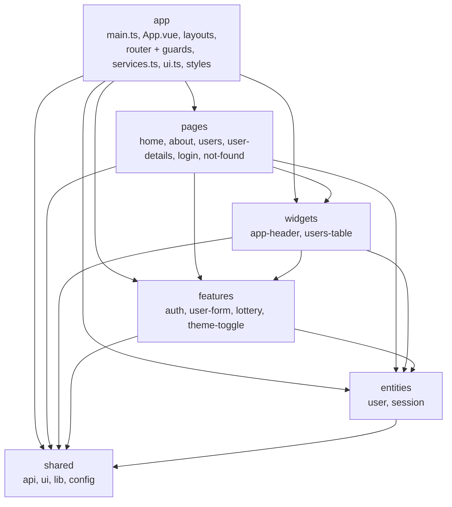

# Vue Lottery: Feature-Sliced Design, Pinia, PrimeVue

Лабораторна робота №6 з курсу «Інженерія клієнтських веб-систем», гілка `feature/fsd` (створена від `feature/routing`).
Застосунок з лабораторної 5 (маршрутизація, користувачі DummyJSON, JWT-авторизація, Repository) реорганізовано за методологією [Feature-Sliced Design](https://feature-sliced.design), стан перенесено в Pinia, а інтерфейс побудовано на UI-бібліотеці [PrimeVue](https://primevue.org).

Демо: https://issaker-33.github.io/vue-lottery-app/fsd/
Тестовий акаунт DummyJSON: `emilys` / `emilyspass`.

## Запуск

```bash
cp .env.example .env   # адреса API та час життя токена
npm install
npm run dev            # dev-сервер Vite
npm run build          # перевірка типів і продакшн-збірка в dist/
npm test               # Vitest
npm run lint:check     # oxlint + ESLint (разом із правилами FSD)
npm run lint:fsd       # лише правила імпортів FSD
npm run deploy:fsd     # збірка й публікація в gh-pages/fsd/
```

| Змінна                   | Призначення                                         |
| ------------------------ | --------------------------------------------------- |
| `VITE_API_URL`           | базова адреса REST API, `https://dummyjson.com`     |
| `VITE_TOKEN_TTL_MINUTES` | час життя `accessToken` для `/auth/login` і refresh |

## Шари та залежності



Правила, які перевіряє лінтер (`eslint.fsd.config.ts`, плагін `eslint-plugin-boundaries`):

1. модуль імпортує лише з шарів, що лежать нижче;
2. слайси одного шару не імпортують один одного (`features/auth` не бачить `features/user-form`);
3. у слайс чи сегмент `shared` заходимо лише через `index.ts` (Public API), глибокі імпорти `@/entities/user/model/...` заборонені;
4. файл поза шарами FSD теж помилка (`boundaries/no-unknown-files`).

Порушення видно як звичайні помилки ESLint у редакторі, у `npm run lint:fsd` і в CI.

## Структура

```
src/
  app/          main.ts, App.vue, layouts/, providers/ (router, services.ts, ui.ts, auth-interceptor.ts), styles/
  pages/        home, about, users, user-details (профіль і вкладене редагування), login, not-found
  widgets/      app-header (AppHeader, AppNavigation, AppLogo), users-table (таблиця, сортування, пошук, видалення)
  features/     auth (LoginForm, LogoutButton, схема входу)
                user-form (UserForm, схеми VeeValidate + Zod)
                lottery (стор і список переможців)
                theme-toggle (стор налаштувань, перемикач теми)
  entities/     user (типи, UserService, useUsersStore), session (типи, AuthService, useSessionStore)
  shared/       api (http-клієнт, інтерфейси Repository, ServiceProvider), ui (обгортки PrimeVue),
                lib (safeRedirect, правила валідації), config (змінні середовища)
```

Кожен слайс має `index.ts`. Наприклад, `src/entities/user/index.ts` відкриває типи, `UserService` і `useUsersStore`, а внутрішні файли `model/` і `api/` назовні не видно.

## Repository у FSD

| Частина                                                                            | Розташування                     |
| ---------------------------------------------------------------------------------- | -------------------------------- |
| HTTP-клієнт, `Readable`, `Searchable`, `Creatable`, `Editable`, `Deletable`        | `shared/api`                     |
| `User`, `CreateUserDto`, `UpdateUserDto`                                           | `entities/user/model/types.ts`   |
| `UserService`                                                                      | `entities/user/api`              |
| `AuthService`, типи сесії                                                          | `entities/session`               |
| `ServiceProvider` (універсальний реєстр `register` / `get`, без імпортів entities) | `shared/api/service-provider.ts` |
| Реєстрація `UserService` і `AuthService`                                           | `app/providers/services.ts`      |

У лабораторній 5 `ServiceProvider` імпортував `UserService` напряму. Шар `shared` не може залежати від `entities`, тому провайдер став реєстром фабрик за ключем, а конкретні сервіси реєструє шар `app`, який бачить усі шари.

## Pinia

Усі стори написано як setup stores. Компоненти дістають стан через `storeToRefs`, а дії деструктуризують напряму. Сторінки й віджети не звертаються до сервісів, лише до сторів.

| Стор               | Слайс                   | Стан і дії                                                                                                             |
| ------------------ | ----------------------- | ---------------------------------------------------------------------------------------------------------------------- |
| `useSessionStore`  | `entities/session`      | `user`, `accessToken`, `refreshToken`, `isAuthenticated`, `setSession`, `clearSession`, `login`, `fetchMe`, `refresh`  |
| `useUsersStore`    | `entities/user`         | `users`, `total`, `isLoading`, `error`, `current`, `fetchUsers`, `fetchUser`, `createUser`, `updateUser`, `removeUser` |
| `useWinnersStore`  | `features/lottery`      | до трьох переможців: `pick`, `remove`, `sync`                                                                          |
| `useSettingsStore` | `features/theme-toggle` | `theme`, `isDark`, `toggleTheme`                                                                                       |

DummyJSON лише імітує POST, PUT і DELETE, тому `useUsersStore` сам пам'ятає створених, змінених і видалених користувачів і накладає ці зміни на кожну сторінку з API.

### Збереження стану: вручну чи плагіном

|          | `session.store.ts` (вручну)                                                                         | `users.store.ts`, `settings.store.ts` (`pinia-plugin-persistedstate`)              |
| -------- | --------------------------------------------------------------------------------------------------- | ---------------------------------------------------------------------------------- |
| Як       | `loadSession()` при створенні, `localStorage.setItem` у `setSession`, `removeItem` у `clearSession` | опція `persist: { key, pick }` у `defineStore`                                     |
| Коду     | ~25 рядків                                                                                          | 4 рядки конфігурації                                                               |
| Контроль | повний: пишемо лише повну сесію, видаляємо ключ при виході                                          | що саме зберігати, задає `pick`, решту робить плагін                               |
| Ризики   | легко забути записати якусь зміну                                                                   | плагін працює лише після `app.use(pinia)`, у тестах його треба підключати так само |

Для токенів залишено ручну реалізацію, бо там важливо, коли саме очищується сховище. Для простих налаштувань і списків змін плагін зручніший.

## UI-бібліотека PrimeVue

- `app/providers/ui.ts` підключає PrimeVue з темою Aura, у якій основний колір замінено палітрою з дизайну (`#3bafda`). Також тут вмикається `ToastService` і темна тема за класом `.app-dark`.
- Компоненти бібліотеки не реєструються глобально. Кожна обгортка імпортує лише свій компонент (`primevue/button`, `primevue/datatable`, ...), тому в бандл і стилі потрапляє тільки використане (tree-shaking).
- Обгортки в `shared/ui`: `AppButton`, `AppInput` (з помилкою валідації), `AppSelect`, `AppTable`, `AppConfirmDialog` (підтвердження видалення), `AppPaginator`, `AppSearchBar`, `AppMessage`, `AppCard`, `AppSpinner`, `AppToast` і `useNotify()`.
- Поза `shared/ui` і `app/providers/ui.ts` жодного прямого імпорту `primevue/*` немає, тож заміна бібліотеки зачепить лише ці файли.
- Toast-сповіщення показують результат операцій: учасника додано, оновлено, видалено, а також помилку авторизації.

## Історія комітів

```
chore: add Pinia, UI library, FSD linter
refactor: introduce FSD folder structure
refactor: split Repository across FSD layers
feat: add Pinia stores
feat: add shared/ui wrappers
refactor: use wrappers and stores in pages and widgets
chore: fix FSD lint errors
feat: add a light and dark theme switch stored with pinia-plugin-persistedstate
docs: describe the FSD layers, stores and UI library
```

## Перевірки

GitHub Actions (`.github/workflows/ci.yml`) для `main` і `feature/**` запускає oxlint і ESLint (з правилами FSD), Prettier, `vue-tsc`, тести Vitest і збірку.
